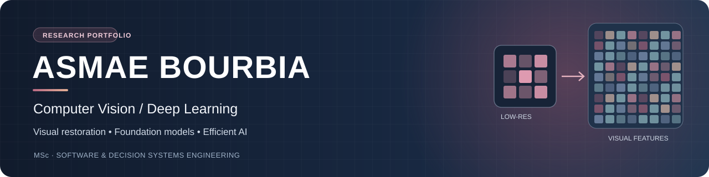
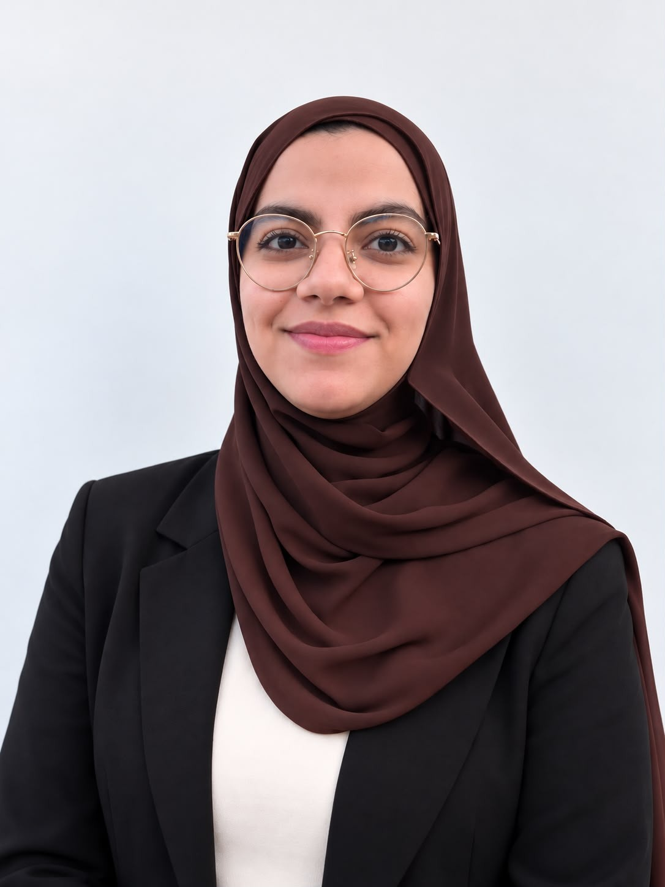
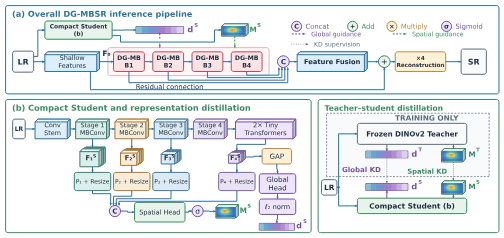
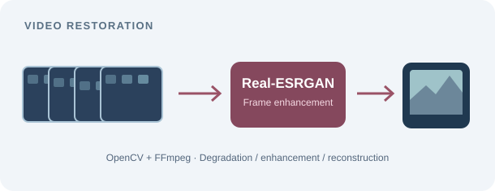
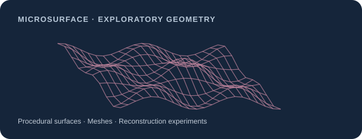

<!--
Asmae BOURBIA | GitHub profile for PhD applications in Computer Vision.
Create a public repository named asmaebourbia and upload README.md with assets/.
DG-MBSR figures and results come from a SUBMITTED manuscript, NOT an accepted publication.
Seek coauthor permission before publicly displaying manuscript figures or lab materials.
Descriptions of projects without code-level verification are limited to the information in the CV.
-->

  

 

### Hi, I'm Asmae 👋

**Computer Vision Research | Deep Learning | Image and Video Restoration | Applied AI**

I hold an **MSc in Software and Decision Systems Engineering** and work at the intersection of **visual perception, efficient neural networks and experimental AI research**. My recent work focuses on **blind image super-resolution** using **DINOv2 representations, Vision Transformers and knowledge distillation**.

During my research internship with **L3i at La Rochelle Université** and **XLIM at Université de Poitiers**, I designed, implemented and evaluated **DG-MBSR**, an efficient restoration model for low-resolution images affected by multiple degradations.

I enjoy the complete research process: reading papers, designing neural architectures, preparing data, training on GPUs, reproducing baselines, running ablations and carefully interpreting both successes and limitations.

🎓 **Seeking a PhD in Computer Vision**, with particular interest in robust image and video restoration, visual foundation models, efficient representation learning and applied visual AI.

 

---

## 🔬 Research Spotlight: DG-MBSR

**DG-MBSR: Degradation-Guided MBConv Super-Resolution for Blind Restoration under Multiple Degradations**

*Master's research internship, L3i and XLIM, 2026*

**Manuscript submitted to IEEE ISCAS 2027. Under review; not accepted or published.**  
Authors: Asmae Bourbia, Mohamed Sakkari, Petra Gomez-Krämer, Mohamed-Chaker Larabi.

  
  
DG-MBSR architecture provided from the submitted manuscript. The frozen DINOv2 teacher is used only during training.

### Research question

How can a **single compact super-resolution model** restore low-resolution images degraded by **blur, noise, haze and rain**, either separately or in combination, without degradation labels at inference?

### What I developed and evaluated

- **Efficient architecture:** a compact student, four degradation-guided MBConv blocks, multi-level feature fusion and PixelShuffle for **4× reconstruction**.
- **Foundation-model guidance:** task-adapted global and spatial representations extracted from a **frozen DINOv2 ViT-S/14 teacher**.
- **Representation distillation:** transferred DINOv2-derived guidance to a lightweight student that operates alone during inference.
- **Adaptive reconstruction:** channel-wise global conditioning paired with globally gated spatial residual corrections.
- **Experimental protocol:** **DIV2K-MD10**, with ten degradation conditions, 8,000 training pairs and 1,000 validation pairs.
- **Scientific evaluation:** compared five baselines, performed component ablations, tested cross-dataset bicubic transfer and studied fidelity, perceptual quality and computational complexity.

### Results reported in the submitted manuscript

| Method | PSNR ↑ | LPIPS ↓ | DISTS ↓ | Parameters | Operations |
|:--|--:|--:|--:|--:|--:|
| **DG-MBSR** | 25.9938 dB | **0.2570** | **0.1742** | **4.12 M** | **5.23 G** |
| CDFormer | **26.5747 dB** | 0.3491 | 0.1867 | 25.80 M | 80.67 G |

On the **synthetic DIV2K-MD10 validation benchmark**, DG-MBSR reports the lowest LPIPS across **all 10 conditions** and the lowest DISTS in **9 of 10** conditions among the compared systems. Compared with CDFormer, the model lowers LPIPS by approximately **26.4%** while using fewer counted operations, with a **0.58 dB PSNR trade-off**.

**Scientific limitations:** the tested corruption pipeline is synthetic and follows a fixed operator order. Generalization to unseen real degradations has not yet been established. These results are from a **submitted, non-peer-reviewed manuscript**, not an accepted paper.

`PyTorch` `DINOv2` `ViT-S/14` `MBConv` `Knowledge Distillation` `PixelShuffle` `Image Restoration` `GPU Training`

---

## 🖼️ Selected Vision and Generative Modeling Projects

<table>
<tr>
<td width="50%" valign="top">
  
  <h3><a href="https://github.com/asmaebourbia/video_sr_project">Video Super-Resolution</a></h3>
  A video processing pipeline that extracts frames, degrades image resolution, applies <b>Real-ESRGAN</b> and reassembles the enhanced video. Explores visual improvements alongside runtime constraints.  
  <code>Python</code> <code>OpenCV</code> <code>FFmpeg</code> <code>Real-ESRGAN</code>
</td>
<td width="50%" valign="top">
  
  <h3><a href="https://github.com/asmaebourbia/MicroSurface-3D">MicroSurface-3D</a></h3>
  Exploratory project involving <b>conditional GAN generation</b> and <b>geometric analysis</b> of synthetic microstructured surfaces. This is presented as an emerging interest in generative modeling, not claimed as prior specialization in 3D point clouds.  
  <code>Python</code> <code>Conditional GAN</code> <code>Geometry</code>
</td>
</tr>
</table>

### Additional computer vision experience

| Academic project | Focus |
|:--|:--|
| **Visual Product Recommendation** | Image embeddings from **ResNet-50** and similarity retrieval using **k-nearest neighbors** for e-commerce applications. |
| **Medical CT Imaging** | Exploratory medical-image preprocessing, volume handling, intensity normalization and introductory learning tasks with **MONAI** and **PyTorch**. |

*Video and MicroSurface images are designed illustrations, not generated experimental results. The DG-MBSR diagram above is the actual figure supplied by the author.*

---

## 🧠 AI Competencies

My background spans multiple AI areas, with **computer vision and image restoration as my primary research specialization**.

| Area | Methods and practical experience |
|:--|:--|
| **Computer Vision and Image Processing** | Image and video restoration, blind super-resolution, image embeddings, visual retrieval, OpenCV, Real-ESRGAN, exploratory medical imaging. |
| **Deep Learning and Neural Networks** | PyTorch, TensorFlow/Keras, CNNs, ResNet-50, MBConv, Vision Transformers, DINOv2, transfer learning and representation distillation. |
| **Visual Foundation Models and Efficient AI** | Frozen pretrained encoders, global and dense features, compact students, teacher-student training, quality versus complexity analysis. |
| **Generative Models** | Conditional GAN-based synthetic microstructured surface generation (exploratory MicroSurface-3D project). |
| **Natural Language Processing** | BERT, RoBERTa, BiLSTM and TextCNN in recommendation and fake-news classification projects. |
| **Machine Learning and Explainability** | scikit-learn, LightGBM, CatBoost, k-NN, model comparison, Optuna hyperparameter optimization, SHAP. |
| **Scientific Research and Evaluation** | Data preprocessing, reproducible train/validation protocols, controlled experiments, benchmarking, ablations, domain transfer, PSNR, SSIM, LPIPS, DISTS. |
| **Engineering and GPU Computing** | Python, NumPy, Pandas, Java, C/C++, SQL, Linux/Bash, Git, Docker, SLURM, GPU experimentation, FastAPI, Spring Boot, REST APIs. |

  
  
  
  
  
  

---

## 💼 Experience

**Research Intern: Computer Vision, Image Restoration and Deep Learning**  
*L3i, La Rochelle Université and XLIM, Université de Poitiers | March to July 2026*

- Designed and evaluated DG-MBSR for blind 4× super-resolution across heterogeneous visual degradations.
- Developed the degradation simulation, PyTorch training workflow, quality evaluation, baseline comparisons and ablation studies.
- Worked with DINOv2, Vision Transformers, GPU experiments and scientific reporting.
- Contributed to a manuscript **submitted to IEEE ISCAS 2027**; a journal extension is in preparation.

**AI Developer Intern: Intelligent Recommendation Systems**  
*AriMayi, France | June to September 2025*

- Contributed to the data processing, modeling and integration of an AI recommendation solution.
- Trained and evaluated models with **LightGBM and BERT**, including **Optuna** hyperparameter search.
- Integrated Python-based services with **FastAPI, Spring Boot and REST APIs**.
- Worked on technical documentation and collaborative development.

---

## 🧪 Other Applied AI Projects

These projects complement the vision-focused work by demonstrating experience with NLP, structured data and explainable ML.

| Project | Methods | Link |
|:--|:--|:--|
| **Water Potability Prediction** | CatBoost, Optuna, cross-validation and SHAP explainability on physicochemical data. | [Repository](https://github.com/asmaebourbia/water-potability-catboost-optuna) |
| **Fake News Detection** | Comparative text classification with BiLSTM, TextCNN and RoBERTa; data preprocessing and leakage analysis. | CV documented |
| **Chronic Disease Prediction** | Structured health data cleaning, ML and neural classifiers, error analysis and performance metrics. | CV documented |
| **Intelligent Waste Management** | Python project on intelligent waste management; see repository for implementation details. | [Repository](https://github.com/asmaebourbia/Syst-me-de-Gestion-Intelligente-des-D-chet) |

---

## 💻 Software Engineering Projects

My background in programming, software architecture and APIs supports experimental research and deployment-oriented prototyping.

| Repository | Key focus |
|:--|:--|
| [UML Generator](https://github.com/asmaebourbia/uml-generator) | Java, Spring Boot, XML/XSLT and generation of UML diagrams. |
| [Nurse on Call](https://github.com/asmaebourbia/NOC-try1) | Healthcare application with microservices and backend integration. |
| [Electrical Network](https://github.com/asmaebourbia/reseau_electrique) | Graph modeling, Dijkstra shortest paths, C and GTK. |
| [Taskmanager](https://github.com/asmaebourbia/taskmanager) | Java project; detailed implementation available in its repository. |
| [KMS](https://github.com/asmaebourbia/KMS) | Public Python project; detailed functionality is not asserted without code review. |

---

## 🎓 Education and Certifications

**MSc in Software and Decision Systems Engineering**  
Mohammed V University, Rabat, Morocco | 2024 to 2026

**BSc in Mathematics and Computer Science**  
Mohammed V University, Rabat, Morocco | 2020 to 2024

**Certifications and additional learning:** IBM fundamentals in AI and cloud computing; Cognitive Class coursework in Big Data, Hadoop, MapReduce/YARN and Apache Pig.

**Languages:** Arabic (native), French (bilingual), English (professional working proficiency).

---

## 🎯 Research Interests and PhD Goals

- **Blind and real-world image restoration**, including super-resolution, denoising and deblurring.
- **Video restoration and temporal consistency** under changing degradation conditions.
- **Pretrained visual representations**, foundation models and domain-adaptive learning.
- **Efficient architectures and knowledge distillation** for resource-constrained inference.
- **Perceptual evaluation, robustness and reproducibility** in machine learning research.
- **Applications** in medical imaging, visual retrieval and multimodal perception.

I am interested in research projects that connect **strong methods, careful empirical validation and meaningful applications**.

  <strong>Open to PhD opportunities and research collaborations in Computer Vision.</strong>
  

    <a href="mailto:asmae.bourbia2@gmail.com">Email</a> ·
    <a href="https://www.linkedin.com/in/asmae-bourbia-43a9aa344/">LinkedIn</a> ·
    <a href="https://github.com/asmaebourbia?tab=repositories">GitHub Projects</a>
  

  Asmae BOURBIA | Computer Vision | Deep Learning | Visual Restoration

